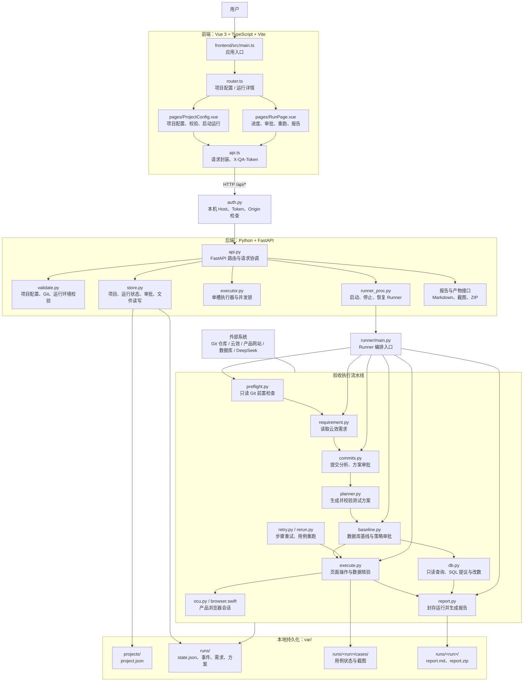
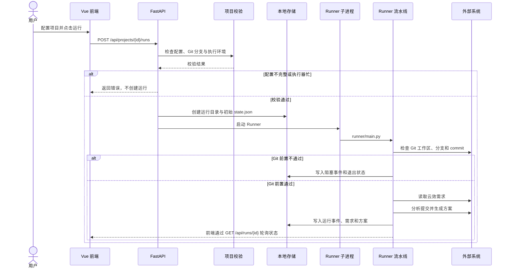
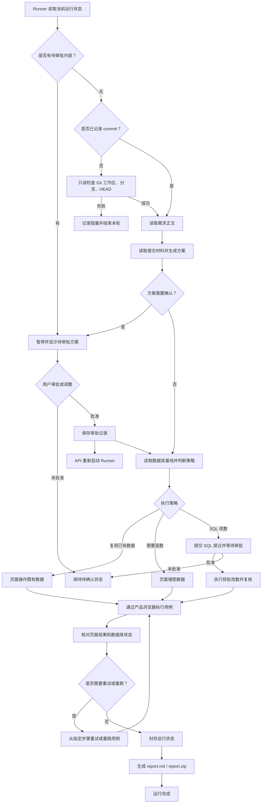
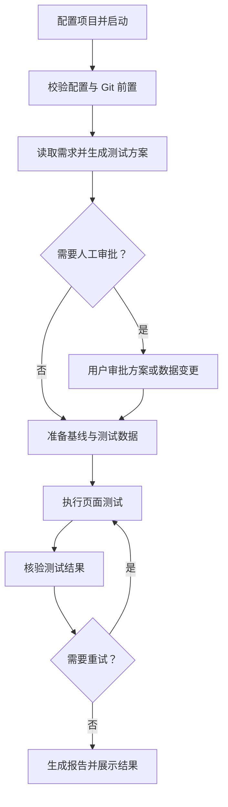

# QA Platform 项目架构与流程图

项目位于 `outputs/qa-platform`。它是一个本机运行的验收测试工作台：Vue 前端负责项目配置、运行控制和结果展示；FastAPI 后端负责校验、调度与存储；独立 Runner 执行 Git 检查、读取需求、生成方案、页面操作与结果核对。

## 1. 项目架构



## 2. 目录职责

| 路径 | 作用 |
|---|---|
| `frontend/src/` | Vue 页面、路由、API 客户端和界面样式 |
| `frontend/dist/` | 构建后的前端静态文件，由后端提供 |
| `backend/qa_platform/api.py` | FastAPI 应用、API 路由、运行生命周期协调 |
| `backend/qa_platform/auth.py` | 本机访问、请求令牌与来源校验 |
| `backend/qa_platform/store.py` | 项目和运行状态的文件存储、审批和产物路径处理 |
| `backend/qa_platform/validate.py` | 项目配置、Git 状态及依赖条件校验 |
| `backend/qa_platform/executor.py`、`runner_proc.py` | 限制并发并启动、停止、恢复 Runner 子进程 |
| `backend/qa_platform/runner/` | Git 前置、需求读取、方案、基线、页面执行、报告等流水线 |
| `schemas/plan.schema.json` | 测试方案结构约束 |
| `var/projects/` | 项目配置数据 |
| `var/runs/` | 每次运行的状态、进度、用例、截图和报告 |

## 3. 新建运行流程



## 4. 方案审批与执行流程



## 5. 前端查看与控制流程

```mermaid
flowchart LR
    ProjectPage[项目配置页] -->|GET / POST / PUT| ProjectsAPI[/api/projects]
    ProjectPage -->|POST| ValidateAPI[/api/projects/{id}/validate]
    ProjectPage -->|POST| StartAPI[/api/projects/{id}/runs]
    RunPage[运行详情页] -->|GET 轮询| RunAPI[/api/runs/{id}]
    RunPage -->|审批、SQL 提议| ApprovalAPI[/approvals、/sql-proposal]
    RunPage -->|停止、继续、重试| ControlAPI[/stop、/continue、/retry]
    RunPage -->|重新运行用例| RerunAPI[/cases/{case_id}/rerun]
    RunPage -->|读取报告和截图| ArtifactAPI[/report、/artifacts/*]
    ProjectsAPI --> Store[var/projects]
    StartAPI --> Runner[Runner 子进程]
    ApprovalAPI --> Runner
    ControlAPI --> Runner
    RerunAPI --> Runner
    Runner --> State[var/runs/&lt;run_id&gt;]
    RunAPI --> State
    ArtifactAPI --> State
```

## 6. 状态与产物

每次运行以 `var/runs/<run_id>/` 为边界保存数据。前端通过运行详情 API 读取 `state.json` 中的阶段、事件、审批、用例状态和当前进度。Runner 同时维护执行进度文件；完成后生成报告，执行过程中的截图和单个用例数据保存在 `cases/` 下。

运行控制由后端单执行器槽管理。启动新运行、重试或审批后继续执行时，后端会检查是否已有运行占用执行器；Runner 也会通过运行目录锁避免同一运行被重复执行。

## 7. 横向运行流程图



图中从左向右表示运行推进方向。运行状态、用例结果和报告保存在 `var/runs/<run_id>/`，前端通过运行详情接口展示。
